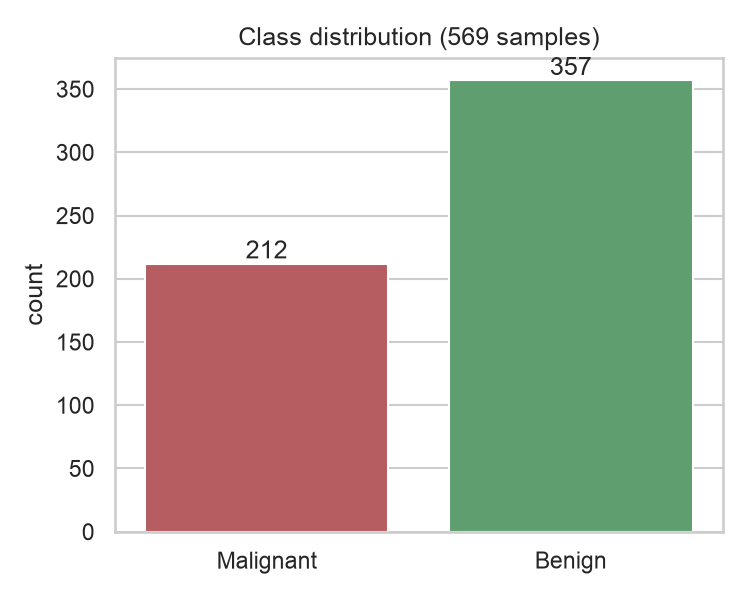
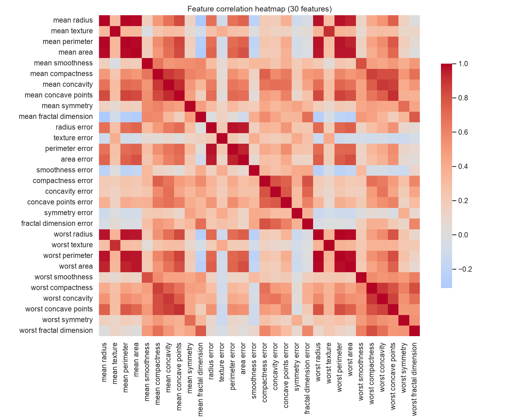
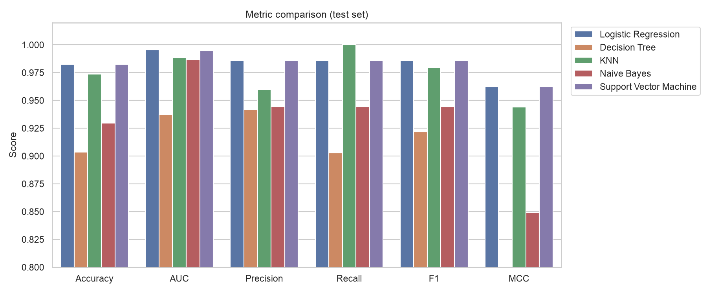
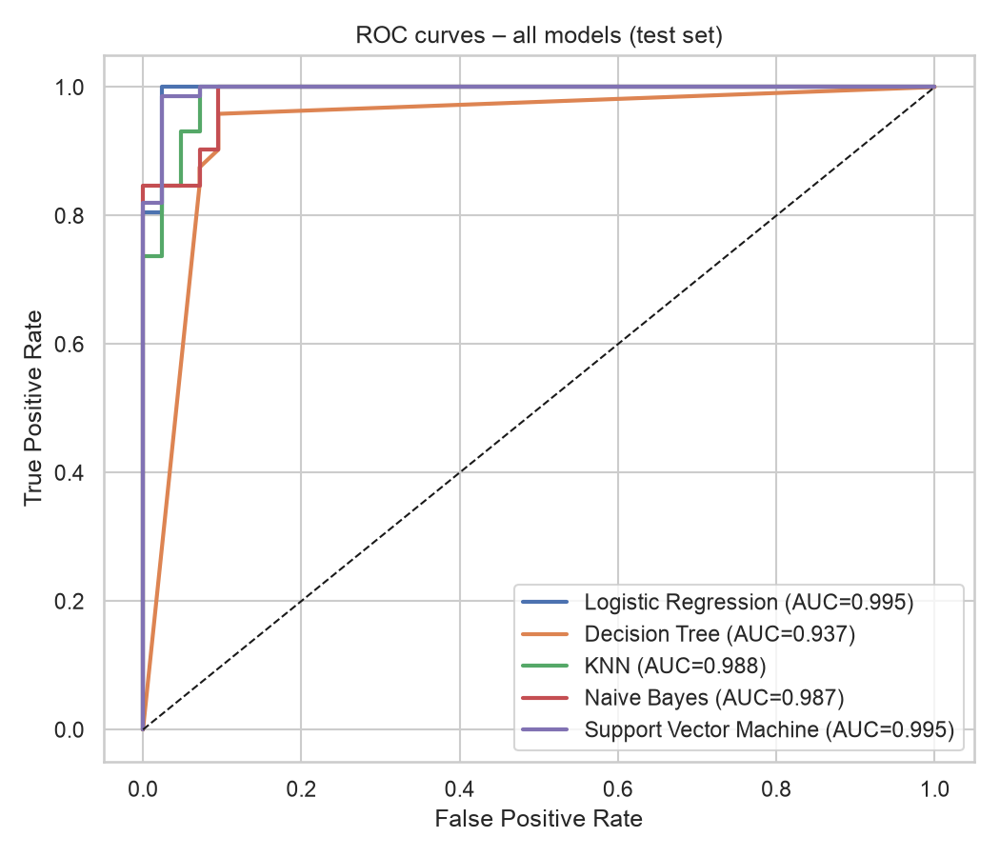
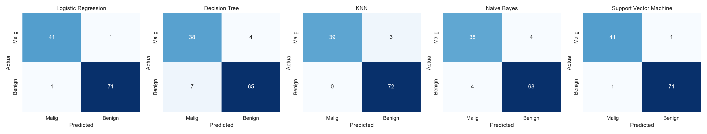
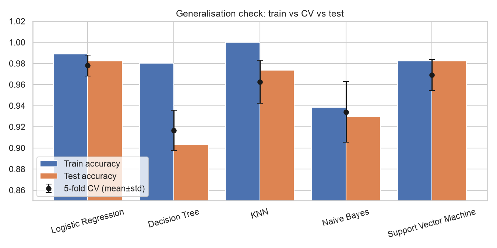
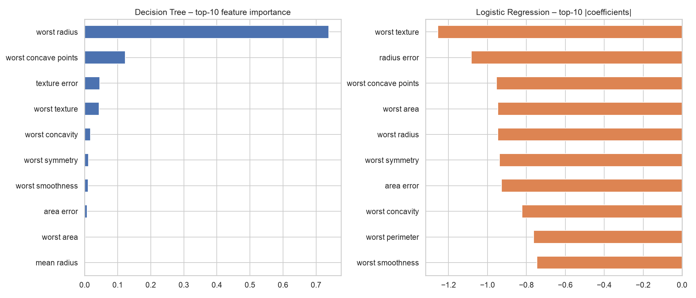

# 🩺 Breast-Cancer Diagnosis – Five-Classifier Comparison & Streamlit Deployment
**BITS Pilani WILP · M.Tech (AIML) · Machine Learning · Assignment 2**

## a. Problem statement
Early, accurate discrimination between **malignant** and **benign** breast tumours from fine-needle-aspirate (FNA) cell-nucleus measurements reduces unnecessary biopsies and prevents missed cancers.
The task is a **binary classification** problem: build, evaluate and compare five classifiers (Logistic Regression, Decision Tree, KNN, Naive Bayes, SVM) on one dataset using six metrics
(Accuracy, AUC, Precision, Recall, F1, MCC), then deploy an interactive Streamlit app that evaluates the *saved* models on an uploaded test CSV without retraining.

## b. Dataset description
| Item | Detail |
|---|---|
| **Source** | Breast Cancer Wisconsin (Diagnostic) – UCI Machine Learning Repository (Wolberg, Street & Mangasarian, 1995), loaded via `sklearn.datasets.load_breast_cancer` |
| **Instances** | 569 (train 455 / test 114, stratified 80:20, seed 42) |
| **Features** | 30 numeric (>= 12 required): 10 nucleus measurements × {mean, standard error, worst} |
| **Target** | `diagnosis` – 0 = malignant (212, 37.3 %), 1 = benign (357, 62.7 %) |
| **Class balance** | Moderately imbalanced (1 : 1.68) → MCC and recall reported alongside accuracy |
| **Missing values** | None |
| **Pre-processing** | `StandardScaler` inside each sklearn `Pipeline` (fit on training data only – no leakage); the saved `.joblib` therefore contains the complete preprocessing |

The 10 base measurements: radius, texture, perimeter, area, smoothness, compactness, concavity, concave points, symmetry, fractal dimension.
Many are strongly collinear (radius–perimeter–area r > 0.95), which matters for Naive Bayes (see observations).


*Figure 1 – Class distribution*


*Figure 2 – Feature correlation heatmap: blocks of highly correlated size features*


## c. GitHub Repository Link
https://github.com/2026aj05790-apeksha/ml-assignment2

```
project-folder/
├── src/                   # application, training, and README-generation code
├── artifacts/             # generated data, models, metrics, and figures
├── test_data.csv          # rubric-required hold-out test data mirror
├── model/                 # rubric-required saved-model mirror
├── problem_statement/     # original assignment PDF
├── submission/            # final PDF and BITS Lab screenshots
├── config/                # student, link, and submission metadata
├── reports/               # grader feedback and reports
└── requirements.txt
```
**Live Streamlit app:** https://ml-assignment2-bxkybtx2fackxbtb4bh9vk.streamlit.app

### How to run / reproduce
```bash
pip install -r requirements.txt
python train.py            # retrains all models and regenerates artifacts/
streamlit run app.py       # launches the evaluation app
```

## d. Models used
All five models are trained on the **same** 455-row training split and evaluated on the **same** 114-row hold-out test set.
Hyper-parameters: LR (C=1), Decision Tree (max_depth=5, min_samples_leaf=3), KNN (k=7, distance-weighted), Gaussian NB (defaults), SVM (RBF, C=1, gamma='scale').

### Comparison table (test set)
| ML Model Name | Accuracy | AUC | Precision | Recall | F1 | MCC |
|---|---|---|---|---|---|---|
| Logistic Regression | 0.9825 | 0.9954 | 0.9861 | 0.9861 | 0.9861 | 0.9623 |
| Decision Tree | 0.9035 | 0.9373 | 0.9420 | 0.9028 | 0.9220 | 0.7969 |
| KNN | 0.9737 | 0.9884 | 0.9600 | 1.0000 | 0.9796 | 0.9442 |
| Naive Bayes | 0.9298 | 0.9868 | 0.9444 | 0.9444 | 0.9444 | 0.8492 |
| Support Vector Machine | 0.9825 | 0.9950 | 0.9861 | 0.9861 | 0.9861 | 0.9623 |

### Generalisation check (5-fold stratified CV on training data vs train vs test)
| ML Model Name | Train Acc | 5-fold CV Acc | Test Acc |
|---|---|---|---|
| Logistic Regression | 0.9890 | 0.978 ± 0.010 | 0.9825 |
| Decision Tree | 0.9802 | 0.916 ± 0.019 | 0.9035 |
| KNN | 1.0000 | 0.963 ± 0.020 | 0.9737 |
| Naive Bayes | 0.9385 | 0.934 ± 0.029 | 0.9298 |
| Support Vector Machine | 0.9824 | 0.969 ± 0.015 | 0.9825 |


*Figure 3 – Metric comparison across models*


*Figure 4 – ROC curves (test set)*


*Figure 5 – Confusion matrices (class 0 = malignant)*


*Figure 6 – Train vs CV vs test accuracy*


*Figure 7 – Feature importance (Decision Tree) and coefficients (Logistic Regression)*


### Observations on model performance
| ML Model Name | Observation about model performance |
|---|---|
| Logistic Regression | Reaches 98.25% accuracy, AUC 0.9954 and MCC 0.962 (tied best), with only 2 errors out of 114 test rows. This works because the malignant/benign classes are almost linearly separable in standardised feature space, so a linear boundary has low bias and, with only 30 inputs, low variance. Train accuracy (0.989) is close to CV (0.978 ± 0.010), indicating no overfitting. Coefficients are directly interpretable (see feature-importance figure). |
| Decision Tree | Weakest model: accuracy 90.35%, AUC 0.937, MCC 0.797. Train accuracy (0.980) far exceeds test accuracy, a classic high-variance overfitting signature even with max_depth=5 and min_samples_leaf=3, because axis-aligned splits must approximate a diagonal boundary with many small steps and 455 training rows are too few to stabilise them. It missed 4 malignant cases (recall 0.903), clinically the worst outcome. Its coarse probability estimates also pull AUC down. Benefit: fully transparent rules. |
| KNN | Accuracy 97.37% and perfect recall (1.000) with 3 missed malignant cases and 0 false positives, so precision (0.960) is the cost. Distance-weighted k=7 on standardised features works because similar tumours cluster in feature space; without scaling it would be dominated by area/perimeter features. Train accuracy is 1.000 (distance weighting memorises training points) while CV is 0.963 ± 0.020, so the CV standard deviation is the largest of the distance-based models and prediction is slower since it stores all data. |
| Naive Bayes | Accuracy 92.98%, MCC 0.849 but a strong AUC of 0.9868, meaning it ranks cases well yet its 0.5 cut-off is poorly calibrated. The independence assumption is violated here because radius, perimeter and area (and their 'worst' versions) are correlated above 0.95 (see heatmap); correlated evidence is counted multiple times, making posteriors overconfident. Train (0.939) and test accuracies are similar, so it suffers from bias rather than variance. It is the fastest model and needs no tuning. |
| Support Vector Machine | Ties with Logistic Regression on every test metric (accuracy 98.25%, AUC 0.9950, MCC 0.962). The RBF kernel maximises the margin and handles any mild non-linearity, and scaling makes gamma='scale' meaningful. CV accuracy (0.969 ± 0.015) is slightly below logistic regression, suggesting the extra flexibility buys nothing on this nearly linear problem while costing training time and interpretability. |
| **Overall, Winner for your dataset?** | **Logistic Regression** (with SVM as a statistical tie). LR and SVM have identical test accuracy (98.25%), MCC (0.962) and recall, but LR has the higher 5-fold CV accuracy (0.978 ± 0.010 vs 0.969 ± 0.015), the highest AUC, trains in milliseconds and is interpretable. We rank by MCC and recall rather than accuracy alone, because MCC is robust to the 63/37 class imbalance and a false negative (missed malignancy) is the costliest error. KNN has the best recall but lower precision/MCC. With only 114 test rows, one sample moves accuracy by 0.88%, so LR vs SVM differences are not significant. |

### Error analysis
15 of 114 test samples are misclassified by at least one model and **1** by all five – these are genuinely borderline tumours whose measurements overlap the other class.
Most of the accuracy gap between models therefore comes from a small set of ambiguous cases, which is why MCC/recall and CV are used in addition to a single test split.

## Streamlit application features
CSV upload (test data only) · model dropdown · six metric cards · confusion matrix + classification report · ROC curve · adjustable decision threshold ·
side-by-side comparison of all five saved models on the uploaded data · prediction download · input validation (missing columns / non-binary target).
Models are loaded with `joblib`; **no training happens in the app**.

## Limitations
* Single public dataset with 569 rows; a 114-row test set gives wide confidence intervals (one sample ≈ 0.88 % accuracy), so LR vs SVM differences are not statistically significant.
* Hyper-parameters were set by reasoned defaults and light CV, not an exhaustive search; data come from one institution, so external generalisation is unverified.
* Models are decision-support tools, not diagnostic devices.

## Future work
* Nested cross-validation with grid/Bayesian search, probability calibration (Platt/isotonic) – especially for Naive Bayes.
* Ensembles (Random Forest, Gradient Boosting, stacking), SHAP explanations, external validation on another cohort.
* Cost-sensitive threshold selection to explicitly minimise false negatives.
